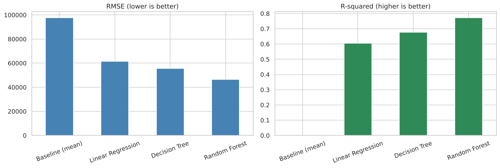
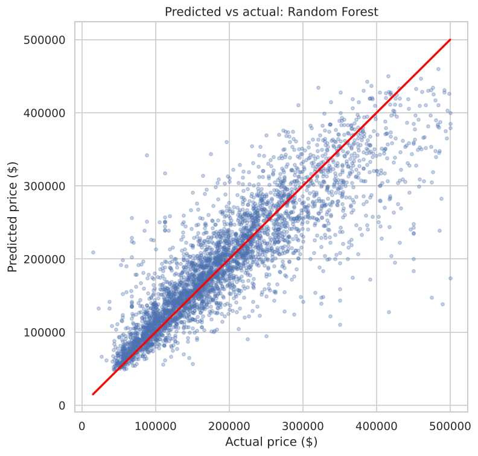

# California House Price Prediction

A beginner machine learning project that predicts the median house value of California neighborhoods from census data. Built to practice **Python, NumPy, pandas, data visualization, and scikit-learn**.

## Problem
Given features of a neighborhood (location, house age, income, rooms, population, distance to the ocean), predict its **median house value**. This is a supervised **regression** problem.

## Dataset
California Housing Prices (`housing.csv`): 20,640 block groups, 10 columns. Target: `median_house_value`.
Source: Kaggle "California Housing Prices" (based on the 1990 US census). Please check the dataset license before redistributing it.

## Project structure
```
data/raw/            original dataset
data/processed/      cleaned and feature-engineered data (created by notebooks)
notebooks/           01 exploration, 02 cleaning, 03 feature engineering, 04 modeling
images/              charts
results/             model comparison table
RUN_GUIDE.md         setup, run, and test instructions
```

## Approach
1. **Exploration:** inspected types, missing values, distributions, correlations, and a map-style scatter plot.
2. **Cleaning:** filled 207 missing `total_bedrooms` with the median, removed rows with capped prices (500,001), removed extreme outliers with NumPy percentiles, and applied a log transform to skewed columns. 20,640 rows became 19,642.
3. **Feature engineering:** rooms, bedrooms, and population per household; one-hot encoding of `ocean_proximity`.
4. **Modeling:** 80/20 split, scaling fit on training data only (no leakage), then a baseline, Linear Regression, Decision Tree, and Random Forest.

## Results (test set)
| Model | MAE | RMSE | R2 |
|---|---|---|---|
| Baseline (mean) | $78,809 | $97,744 | 0.00 |
| Linear Regression | $44,499 | $61,498 | 0.60 |
| Decision Tree | $38,113 | $55,630 | 0.68 |
| **Random Forest** | **$30,900** | **$46,557** | **0.77** |

The Random Forest explains about 77% of the variation in prices and is off by roughly $31,000 on average.




## Key findings
- `median_income` has by far the strongest correlation with price (about 0.69).
- Inland neighborhoods are much cheaper than coastal ones; the map plot shows high prices hugging the coast.
- Prices are capped at $500,001 in the raw data, so those rows were removed.

## Limitations and next steps
- The data is from 1990, so the model says nothing about current prices.
- Removing capped rows means the model is not trained on the most expensive areas.
- Next: hyperparameter tuning with cross-validation, Gradient Boosting, and a small Streamlit app.

## Author
Nonim | https://github.com/nonimml
